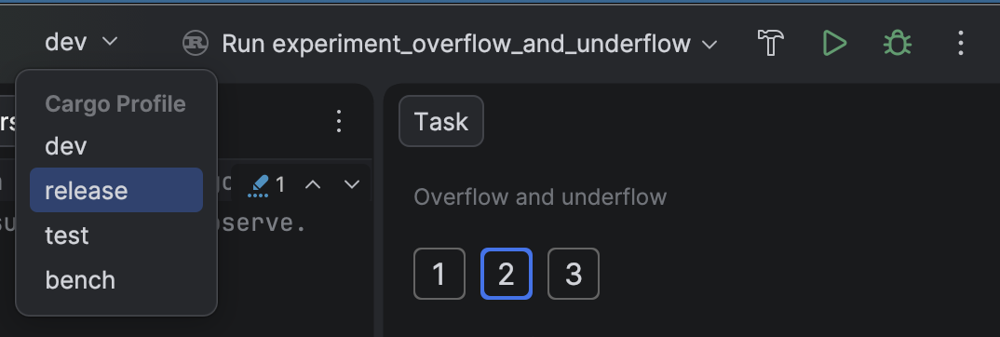
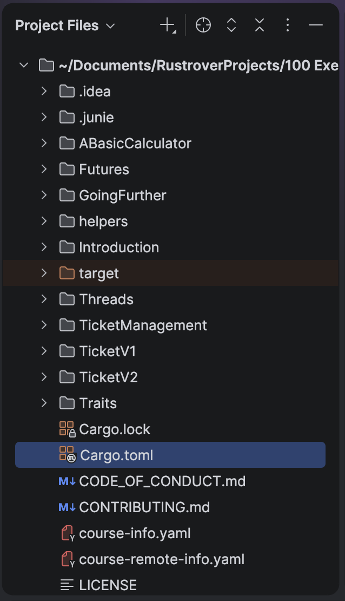

Це практичний **експеримент** — здавати нічого не потрібно. Просто запустіть код і
подивіться, що станеться.

У `main.rs` визначено ту саму функцію `factorial`, що й раніше, і викликано
`factorial(20)`. Як пояснювалося в теорії, `20!` значно більше за `u32::MAX`, тому
це множення спричиняє переповнення.

## Запустіть код у профілі `dev`

Запустіть `main.rs` як є (зелена кнопка **▶** поруч із `main`). Профіль `dev`
за замовчуванням задає `overflow-checks = true`, тому програма **панікує** з повідомленням
`attempt to multiply with overflow`.

## Увімкніть перехід по колу

Тепер змініть профіль, з яким компілюється код, щоб у *тому самому коді* замість паніки відбувався
**перехід по колу** (wrap around). Спробуйте два варіанти: **профіль release** і
**власний профіль dev**.

### Профіль release

Щоб запустити код у профілі release, виберіть `release` у випадному меню вгорі
вікна IDE, а потім натисніть зелену стрілку праворуч від нього.



У профілі `release` задано `overflow-checks = false`, тому результат `factorial(20)` переходить по колу, і програма виводить `2192834560`.

### Власний профіль `dev`

Додайте наведений нижче фрагмент до `Cargo.toml` у **корені репозиторію** й знову запустіть код у профілі `dev`.

```toml
[profile.dev]
overflow-checks = false
```

Налаштування профілів зчитуються лише з кореня робочого простору (workspace), а не з власного `Cargo.toml` завдання.
Щоб знайти кореневий `Cargo.toml`, виберіть у вікні курсу `Project Files` замість `Course`.



Запустіть код у профілі `dev`. Тепер перехід по колу відбувається й у `dev`. Завершивши експерименти, скасуйте цю зміну.

## Підсумок

Той самий код, але різна поведінка залежно від профілю — ось як працює `overflow-checks`.
