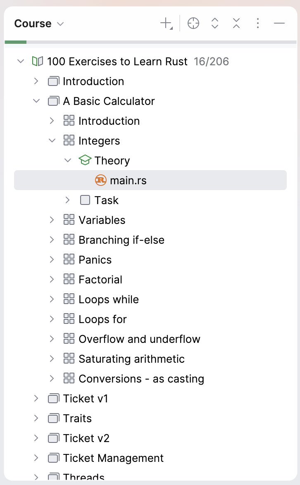

## Вікно курсу

**Course View** (вікно курсу) показує програму курсу: список уроків із завданнями.

Щоб перейти до будь-якого завдання, двічі клацніть його назву.

Щоб сховати вікно Course View, клацніть кнопку Project Tool Window або натисніть &shortcut:ActivateProjectToolWindow;. Так у вас буде більше місця для редактора та вікна Task Description.

Щоб повернути сховане вікно Course View, клацніть кнопку Project Tool Window ще раз (або повторно натисніть &shortcut:ActivateProjectToolWindow;).
