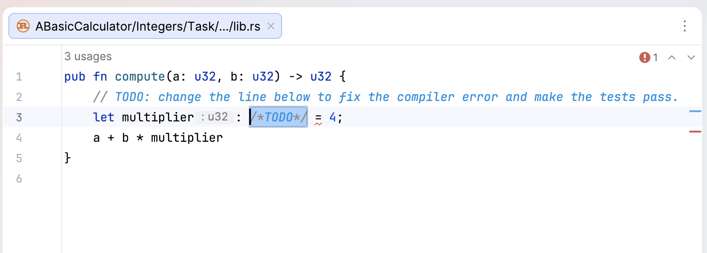
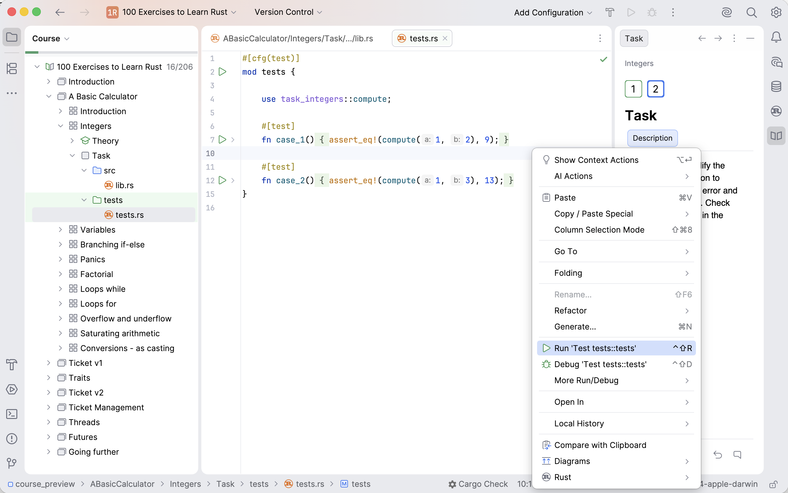

## Редактор

**Редактор** (Editor) — ваш майданчик для програмування. У теоретичних завданнях тут можна вільно експериментувати: нічого не перевіряється.

У завданнях із програмування саме в редакторі ви виправлятимете наявний код або писатимете власний з нуля. Цей код перевірятиметься.

Якщо в завданні немає функції `main`, його тести однаково можна запустити: відкрийте теку `tests`, виберіть **Run** у контекстному меню або натисніть &shortcut:Run;:

Інший спосіб перевірити код конкретного завдання — натиснути кнопку **Check** під описом завдання.

Іноді корисно запустити функцію `main` з файлу `main.rs`, щоб побачити, що виводить ваш код. Зверніть увагу: така функція є не в кожному завданні.
Якщо ви хочете повернутися до редактора й зосередитися на коді, найшвидше це зробити командою Hide All Windows (&shortcut:HideAllWindows;). Щоб повернути всі вікна, виконайте цю команду ще раз.
