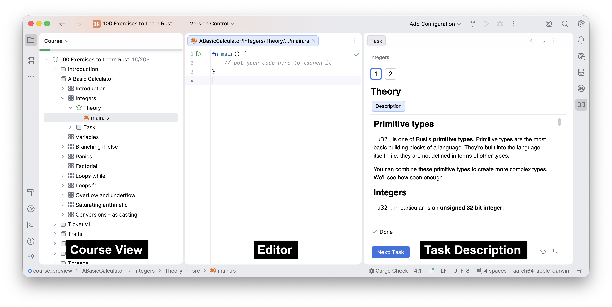

### Огляд плагіна JetBrains Academy
##
Цей урок допоможе вам зробити перші кроки з [плагіном JetBrains Academy](https://www.jetbrains.com/help/education/educational-products.html) і почати вивчати Rust за його допомогою.

Плагін JetBrains Academy дає змогу вивчати мови програмування та інструменти, виконуючи завдання з програмування, і отримувати миттєвий зворотний зв'язок просто в IDE.

Досить розмов — почнімо!

Якщо ви вже знайомі з інтерфейсом, цей урок можна пропустити.

### Робота з курсами
Кожен курс у JetBrains Academy складається зі списку уроків. Уроки, своєю чергою, можуть бути згруповані в розділи. Кожен урок містить кілька завдань.

Відкривши курс, ви побачите основні вікна інструментів для навігації: **Course View** (вікно курсу), **Editor** (редактор) і **Task Description** (опис завдання):

Щоб перейти до наступного завдання, натисніть кнопку **Next**.
