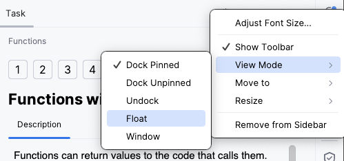

## Опис завдання

Вікно **Task Description** (опис завдання) містить усю інформацію, потрібну для виконання завдання.

У теоретичних завданнях тут навчальний матеріал для читання.
У завданнях із програмування тут сформульовано умову: що саме потрібно зробити.

Елементи вікна Task Description дають змогу виконувати такі дії:

| Елемент                                                           | Опис                                                                                                  |
|-------------------------------------------------------------------|-------------------------------------------------------------------------------------------------------|
| **Check**                                                         | Перевірити розв'язок завдання з програмування                                  |
| **Run**                                                           | Запустити код (у теоретичному завданні)                                        |
|                                               | Перейти до попереднього завдання                                               |
|  &nbsp;або **Next** | Перейти до наступного завдання                                                 |
|                                              | Скасувати всі зміни, зроблені в завданні, і почати спочатку                    |
|                                        | Залишити коментар до конкретного завдання                                      |
| **Peek Solution...**                                              | Показати авторський розв'язок і <b>diff</b> — різницю з вашим кодом            |
|                                       | Змінити параметри відображення вікна Task Description                          |
|                                     | Сховати вікно Task Description                                                 |

Радимо тримати вікно Task Description відкритим під час роботи. Якщо воно все ж заважає, його можна сховати кнопкою **Hide** () у правому верхньому куті вікна.

Якщо у вас два монітори, зручно відкріпити панель Task Description (режим **Float**) і перенести її на другий монітор або просто розмістити поруч із головним вікном IDE. Для цього натисніть значок налаштувань вікна інструментів :

