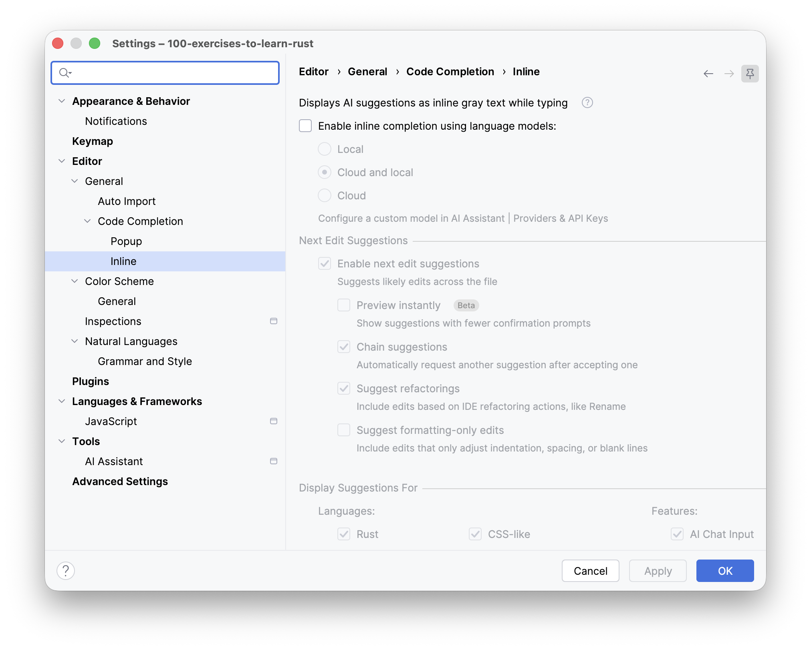
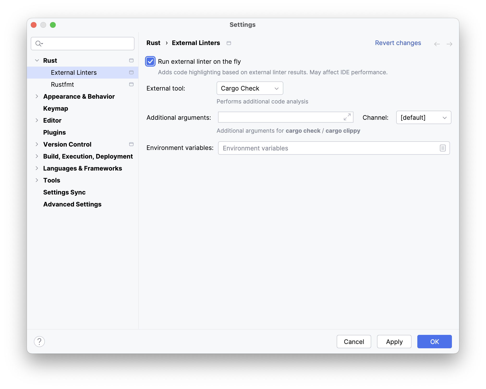

Перш ніж почати, зробіть три швидкі кроки.
Перший обов'язковий, бо без нього тут нічого не запуститься; два інші — наші рекомендації для цього курсу.

### 1. Перевірте, чи є у вас Rust toolchain (набір інструментів)

Без нього в цьому курсі нічого не скомпілюється, тож варто приділити цьому пів хвилини вже зараз.

Відкрийте **Settings / Preferences | Rust** і подивіться на поле **Toolchain version**.
Якщо там указано версію, усе готово. Якщо ж там `N/A`, натисніть **Install Rustup** і дочекайтеся завершення:
буде встановлено і toolchain, і стандартну бібліотеку.

Якщо автоматичне налаштування не спрацювало або ви хочете підключити до IDE toolchain, який у вас уже є, див.
**Чи треба встановлювати Rust?** у наступному уроці.

### 2. Вимкніть автодоповнення коду на основі ШІ

Радимо вимкнути автодоповнення на основі ШІ на весь час проходження курсу.

Вправи навмисно невеликі, і підказка ШІ часто видає готову відповідь цілком, поки ви ще читаєте умову завдання.
Це зручно, але ж саме в цю мить і мало відбуватися навчання.
Коли працюватимете над власними проєктами, автодоповнення завжди можна ввімкнути знову.

1. Перейдіть до розділу **Settings / Preferences | Editor | General | Code Completion | Inline**.
2. Зніміть прапорець **Enable inline completion using language models**.
3. Натисніть **OK**.

> 💡 **Примітка**
>
> Це не вимикає звичайне автодоповнення коду — спливний список методів і типів, які справді доступні в поточному
> scope (ділянка коду, де змінна доступна). Його залиште! Воно ґрунтується на тому, що компілятор знає про ваш код,
> а переглядати, що пропонує той чи інший тип, — добрий спосіб познайомитися зі стандартною бібліотекою.

Водночас ми всіляко заохочуємо просити ШІ-асистента щось _пояснити_.
Див. **Чи можна користуватися ШІ?** у наступному уроці.

### 3. Перевірте, чи ввімкнено зовнішній linter (лінтер)

А от цей параметр, навпаки, має бути _ввімкнений_. Linter запускає `cargo check` просто під час набору коду, тож
справжні помилки компіляції ви бачите одразу в редакторі, а не дізнаєтеся про них лише тоді, коли запускаєте тести.
Цей курс значною мірою спирається на читання повідомлень компілятора, тож варто переконатися, що linter працює.
Зазвичай він увімкнений за замовчуванням.

1. Перейдіть до розділу **Settings / Preferences | Rust | External Linters**.
2. Задайте такі параметри:
   - Установіть прапорець **Run external linter on the fly**.
   - У списку **External Tool** виберіть **Cargo Check**.
3. Натисніть **OK**.

